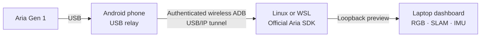

# Aria USB Relay

Use an Android phone to relay **Project Aria Gen 1 glasses over USB** to a laptop. A local desktop dashboard shows live RGB, both SLAM cameras, and both IMUs. The glasses' Wi-Fi is not used.

The phone keeps the USB session in an Android foreground service. Linux runs the official Aria Client SDK and decodes the sensor stream; the dashboard runs locally on the laptop. The phone still needs a reliable connection to the laptop through wireless ADB. This is an experimental research tool, not an offline sensor recorder or a standalone Android Aria SDK.



## What works

- A bounded phone connection journal, with direct USB telemetry available for debug diagnostics.
- USB/IP transport, USB NCM networking, authenticated SDK streaming, and live camera/IMU decoding.
- A laptop dashboard for pairing, installation, diagnostics, session control, and live viewing.
- Bounded transfer queues and latest-sample preview buffers; missing and stale data are labeled.
- Scoped stop helpers that verify session identity before requesting cleanup.

The verified hardware path is Aria Gen 1 → Pixel 9 Pro XL → Windows with Ubuntu 22.04 in WSL2, using SDK 2.5.0 and `profile12`. The current APK was installed through the desktop dashboard, and its new launcher/controller pipeline delivered all three cameras and both IMUs. See [compatibility](docs/compatibility.md) and the [sanitized validation record](docs/research/usbip-live-run.md) for the limits of that evidence. Native Linux launchers have mocked workflow and offline tests; their full hardware path has not yet been validated.

## Windows + WSL quickstart

You need a USB data cable, an Android phone with USB host support, Aria Gen 1 with ADB enabled, and a reachable phone-to-laptop network. On the laptop install **Python 3.10+**, **PowerShell 7**, **Android SDK Platform-Tools**, and **WSL2 Ubuntu**. Building the APK additionally requires JDK 17+ and Android SDK Platform 36 / Build-Tools 36.1.0. [Setup details](docs/setup.md) cover Linux modules, mirrored networking, and the SDK environment.

1. Build the Android app from the repository root:

   ```powershell
   .\build.ps1 assembleDebug --no-daemon
   ```

2. Prepare the Linux SDK environment and complete the official Aria pairing flow as your normal Linux user. The opt-in setup helper installs dependencies but does not replace pairing or copy existing certificates:

   ```powershell
   wsl -d Ubuntu-22.04 -u root --cd /mnt/c/path/to/aria-android --exec bash scripts/setup-wsl.sh --user YOUR_LINUX_USER
   ```

3. Open the local dashboard:

   ```powershell
   .\scripts\open-dashboard.ps1
   ```

   Or run `python desktop/server.py`. It opens `http://127.0.0.1:8766/`; `--no-open` suppresses browser launch.

4. On the phone enable **Developer options → Wireless debugging**. Use the dashboard to pair with the displayed pairing address and code, connect to the separate debugging address, and install the APK. Connect the glasses to the phone, tap **Start relay** in Aria USB Relay, and accept Android's USB permission prompt.

5. Run the dashboard's checks, start the stream, and watch live data on the laptop. Keep the laptop decoder running. Android may request USB permission again when the glasses switch to USB networking.

To use the command line instead:

```powershell
.\scripts\doctor.ps1 -Device 'PHONE_IP:CONNECTION_PORT'
.\scripts\install.ps1 -Device 'PHONE_IP:CONNECTION_PORT'
.\scripts\start-live.ps1 -Device 'PHONE_IP:CONNECTION_PORT'
```

`start-live.ps1` accepts `-Distro`, `-LinuxUser`, `-SdkPath`, `-AriaSerial`, and `-Profile`. It allocates a free local forwarding port and keeps Linux ADB separate from Windows ADB. Pairing codes, device addresses, and machine paths belong in local settings, not source files.

Use **Stop stream** in the dashboard, Ctrl+C in the launcher terminal, or `./scripts/stop-live.ps1`. `-Check` validates the recorded session without stopping it. Closing the **browser tab** leaves the stream running. Stopping the **dashboard launcher**, for example with Ctrl+C, attempts to stop the stream that launcher owns. Forced termination can prevent cleanup; use the stop helper if a session remains active.

## Native Linux

The decoder and USB/IP importer also run on native Linux with `vhci_hcd`, `cdc_ncm`, DHCP support, and the official Gen 1 SDK. The phone remains the USB host. See [native Linux setup](docs/setup.md#native-linux) for prerequisites and launcher commands. This path is provided for the first release but is not presented as hardware-verified.

## Limits and recovery

This release previews RGB, SLAM, and IMU data. It does not implement audio, durable sensor recording, replay, or standalone Android DDS decoding. Preview drops are expected when the link or decoder falls behind; queues are bounded and older frames are discarded. A foreground service supports background operation, but does not exempt the phone from network loss, Doze, or vendor power policies. Disconnecting USB may require renewed system permission.

On the tested Pixel, streaming continued through a 68-second screen-off check. A brief wireless ADB interruption also recovered after an explicit phone reconnect, without restarting the decoder. These checks do not establish prolonged Doze reliability, automatic network reconnection, or lossless recovery.

If startup stalls after an interrupted USB configuration change, stop the session, physically unplug and reconnect the glasses, then start again and approve USB access. This recovered the tested setup. Automatic recovery from every interrupted state is not implemented. [Troubleshooting](docs/troubleshooting.md) covers discovery, pairing, DHCP, stale frames, and shutdown.

## Development and releases

- [Architecture and data flow](docs/architecture.md)
- [Build, versioning, and release signing](docs/releases.md)
- [Contributing and validation](CONTRIBUTING.md)
- [Security and private artifacts](SECURITY.md)
- [Changelog](CHANGELOG.md)

CI builds debug and unsigned release APKs, runs Android lint, runs JVM/Python tests on Linux and Windows, and checks public files for private artifacts. Hardware streaming requires the real glasses and is not emulated by CI.

This project is licensed under [MIT](LICENSE). The official Aria SDK and other external dependencies retain their own licenses and are installed separately. No Meta companion binaries, certificates, captures, or signing keys are distributed here. This is an independent project, not an official Meta product.
